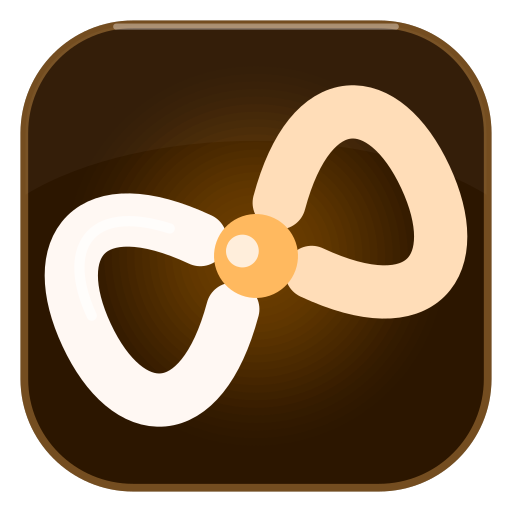

<div align="center">



# NectarLink

**Your Android phone and your PC, working as one in a WinUI version.**

Notifications, messages, calls, clipboard, files, photos, screen mirroring and
phone apps in windows, between Android and Windows 10 (2004+), Windows 11 or Linux. Free and open source.
Local-first, end-to-end encrypted, no account and no cloud.

A community-based Windows app for the original NectarLink project, with:
- Enhanced user interface
- Support for newer Windows features (glass effects, animations, etc.)

Feedback, bugs or ideas? DM me directly, or come hang out in the
[Terrace on Discord](https://discord.gg/Y3mjXM9NvK).

[](https://github.com/isaiahscape/nectarlink-winui/releases/latest)
[](LICENSE)

</div>

<p align="center">
  
</p>

## Why NectarLink

NectarLink came out of the original dev'sfrustration. He kept juggling Phone Link for
notifications and messages, KDE Connect for the clipboard and LocalSend for
files, and always wanted one app that did all of it.

It covers what those three did for me, with one app on each side, plus a lot
of new features I wanted that I think you'll enjoy having too.

## Download

| | Download | Needs |
|---|---|---|
| **Windows (x64)** | [Installer (.exe)](https://github.com/isaiahscape/nectarlink-winui/releases/latest) | Windows 10 (2004+) or 11, 64-bit Intel or AMD (Phone as webcam needs Windows 11) |
| **Windows (ARM64)** | [Installer (.exe)](https://github.com/isaiahscape/nectarlink-winui/releases/latest) | Windows 11 on ARM (Snapdragon) |
| **Android** | [App (.apk)](https://github.com/thtbee/nectarlink/releases/download/v0.1.5/Nectarlink-0.1.5-android.apk) | Android 8.0 or newer |

The apps update themselves from GitHub Releases and check every download
against its SHA-256 sums.

> [!NOTE]
> SmartScreen may warn about the Windows installer the first time, because it
> isn't code-signed yet: choose **More info**, then **Run anyway**. On Android,
> allow your browser or file manager to install apps when asked.

> [!IMPORTANT]
> In India and many other countries, Google Play Protect blocks the APK with
> no **Install anyway** button. Pause **Scan apps with Play Protect** while you
> install it (Play Store › your profile › Play Protect › Settings), then turn it
> back on, or install it from a PC with `adb install`. See
> [Play Protect blocks the APK](docs/guide/troubleshooting.md#google-play-protect-blocks-the-apk-without-an-install-anyway-button).

## Get started

1. Install NectarLink on your PC and on your phone.
2. On the PC, the setup walkthrough shows a QR code. Scan it with the phone
   (from the NectarLink app or any camera app), or pick the PC from the phone's
   list of nearby devices and compare a 6-digit code. A USB cable works too, with Android's `adb` running on the PC.
3. Allow what you want to share. Every feature has its own switch per device,
   and the sensitive ones are off until you turn them on.
4. Optional: set up **Wireless debugging** once in the phone app for the
   features Android reserves for privileged apps (phone apps in windows, real
   touch input, background clipboard sync). No root, nothing else to install.

The [user guide](docs/guide/README.md) walks through every step and feature.

## What it does

**Stay on top of your phone**
- **Notifications** on the PC, with replies, actions, Live Updates (progress,
  timers, deliveries) and a **Copy code** button for one-time codes. Clear on
  one side, cleared on the other.
- **Messages**: SMS and MMS conversations plus chats from RCS, WhatsApp,
  Telegram, Signal and other apps in one inbox. Reply, send pictures, start
  new conversations.
- **Calls**: see who's calling, answer, decline or hang up from the PC, call
  any number or contact through the phone, and browse recent calls.

**Move things between devices**
- **Clipboard**: copy on one device, paste on the other, with optional
  encrypted history. Passwords from password managers are never sent, and
  one-time codes are never kept in the history.
- **Files and folders** both ways at Wi-Fi speed, with resume after a dropped
  connection, **Send to** in File Explorer, and the phone's storage in File
  Explorer. It also works with LocalSend devices, without pairing.
- **Synced folders**: keep a phone folder and a PC folder in step, one way or
  both ways, with a copy kept when a file changed on both sides.
- **Photos**: the phone's camera roll, screenshots and albums on the PC, and
  **Photo backup**, which copies new photos into a folder on the PC by year and
  month and never deletes anything.
- **Handoff**: links, maps and videos (at the same timestamp) open on the
  other device.

**Use your phone from the PC**
- **Screen mirroring** at up to 60 frames a second with the phone's sound,
  screenshots and recording.
- **Apps**: open any phone app in a window of its own on the PC, with its own
  taskbar icon, running beside whatever the phone shows.
- **Type on the phone** with the PC keyboard, without mirroring.
- **Phone controls** on the PC: Do Not Disturb, ringer, volume, flashlight,
  brightness, Wi-Fi and Bluetooth.

**Use your PC from the phone**
- **Touchpad, air mouse, keyboard, voice typing and presentation remote.**
- **Your PC's screen on the phone**, with control from the phone.
- **Deck**: a Stream Deck style grid of buttons for the PC (media, shortcuts,
  apps, OBS Studio, commands), with live volume and mute.
- **Lock, sleep and wake** the PC.

**Camera and sound**
- **Phone as a webcam** in Zoom, Teams, Meet, OBS and the Camera app.
- **Continuity Camera**: take a photo or scan a document with the phone and
  have it on the PC's clipboard.
- **Phone as a speaker** for the PC's sound, and a **voice recorder** that
  saves straight to the PC.
- **The phone's sound on the PC**, without a mirror window.
- **Phone as a microphone** for Discord, Zoom, OBS or Teams, through a virtual
  audio cable such as VB-CABLE.
- **Play on phone**: carry on with the video playing on the PC.

**And more**: media controls both ways, battery alerts, Find my device, a
searchable **Timeline** of everything that moved, a **Command Palette**
(`Ctrl+Alt+Space`), a slide-out **Shelf**, a home-screen widget, and a
**Connection Doctor** that finds and fixes what keeps devices from connecting.
An optional **Nectar Island** at the top of the screen shows calls, music and
transfers. Five themes, **Hive**, **Bloom**, **Glass**, **Graphite** and **Fluent**, each
in light and dark. In English, German, Turkish, Simplified Chinese, Brazilian Portuguese, Vietnamese, Spanish and Russian.

### Platform support

| Feature | Windows |
|---|---|---|---|
| Pairing & mutual TLS | Yes | Yes | Yes |
| Files & folder transfer | Yes | Yes | Yes |
| Photos browser & download | Yes | Yes | Yes |
| Continuity Camera | Yes | Yes | Yes |
| Calls & SMS viewer | Yes | Yes | Yes |
| Phone quick toggles & volume | Yes | Yes | Yes |
| Clipboard text & image sync | Yes | Yes | Yes (two-way text, incoming photo) |
| System notifications | Yes | Yes | Yes (system banners) |
| Phone screen mirroring | Yes | Yes | Yes (H.264) |
| Screen recording (MP4) | Yes | Yes | Yes (H.264) |
| PC audio stream / phone mic | Yes | Yes | Yes (PC audio needs Screen Recording permission) |
| Phone as webcam | Yes | Yes (with v4l2loopback) | Not yet (needs a Developer ID signed build) |
| Phone storage in the file manager | Yes | Yes | Yes (Finder via WebDAV) |

## Private by design

- **Local-first.** Devices talk directly over your network, a USB cable or
  Tailscale. Nothing goes through a server, and there's no account.
- **End-to-end encrypted.** Every connection is QUIC with TLS 1.3, authenticated
  with device keys exchanged when you pair. Keys are protected by Windows DPAPI,
  the macOS Keychain and the Android Keystore. On Linux, for now, only by file permissions.
- **You decide what's shared.** Each paired device has its own feature
  switches. Remote control of the PC, shell commands and phone storage are off
  until you allow them.
- **The only internet traffic** is the update check against GitHub (which you
  can turn off), an anonymous daily count (app version, platform and device
  model, no ID), problem reports you choose to send, and, if you turn it on,
  **Connect over mobile data**, which relays encrypted traffic it can't read.
  Voice typing uses your phone's own speech recognizer, which may use its
  provider's servers.

Details: [Privacy and security](docs/guide/privacy-and-security.md) and the
[security model](docs/technical/security-model.md).

## Screenshots

<p align="center">
  <br>
  <sub>The phone's apps on the PC, each in a window of its own.</sub>
</p>

<p align="center">
  <br>
  <sub>The phone's texts on the PC.</sub>
</p>

<p align="center">
  <br>
  <sub>The whole phone screen in a window, with mouse and keyboard control.</sub>
</p>

<p align="center">
  <br>
  <sub>Pairing by QR code, and the Android app once connected.</sub>
</p>

## How it works

```
 Android app (Kotlin, Compose)            Desktop app (Qt Quick, Rust)
          │ UniFFI                                │ cxx-qt
          ▼                                       ▼
 ┌─────────────────────┐   QUIC (iroh),   ┌─────────────────────┐
 │  nectarlink-core    │◄────────────────►│  nectarlink-core    │
 │  pairing, sessions, │  end-to-end      │  pairing, sessions, │
 │  storage, features  │  encrypted       │  storage, features  │
 └─────────────────────┘                  └─────────────────────┘
```

- **One core, two apps.** Protocol, pairing, sessions, the trust store and the
  capability matrix live in Rust (`core/`) and run unchanged on both platforms.
- **Native on both sides.** A desktop app for Windows and Linux built with Qt
  Quick and Rust, and an Android app built with Jetpack Compose.
- **Capability matrix.** Both apps work out which features a pair of devices
  supports and what would enable the rest, so the interface never offers
  something that can't work.
- **Protocol.** Versioned and documented in [docs/protocol/v0.md](docs/protocol/v0.md):
  length-prefixed CBOR messages on QUIC streams.

## Repository layout

```
core/
  nectarlink-protocol/   Message types, framing, pairing cryptography      (MPL-2.0)
  nectarlink-core/       Identity, trust store, pairing, sessions, features (MPL-2.0)
  nectarlink-ffi/        UniFFI bindings used by the Android app          (MPL-2.0)
  nectarlink-adb/        Client for the PC's adb, for USB connections      (MPL-2.0)
  nectarlink-cli/        Command-line client (`nectarlink`)                (GPL)
desktop/
  app/                   Desktop app: Rust host, cxx-qt bridge, QML UI     (GPL)
  vcam/                  Windows 11 virtual camera Media Foundation DLL    (GPL)
  installer/             NSIS installer script and Sparse Package manifest (GPL)
  packaging/             Linux packages and the install script             (GPL)
android/                 Android app: Kotlin and Jetpack Compose (API 26+) (GPL)
assets/fonts/            Fonts both apps ship with                         (OFL-1.1)
assets/brand/            The app icon (see the trademark policy)
tools/xtask/             Code generation (theme tokens) and checks         (GPL)
third_party/             Patched copies of dependencies, under their own licenses
spikes/                  Technical experiments with their results
scripts/                 Build, packaging and check scripts
docs/                    Guide, technical docs, protocol, design system    (CC BY 4.0)
```

## Building from source

| Part | Needs |
|---|---|
| Core and CLI | [Rust](https://rustup.rs) (stable, pinned in `rust-toolchain.toml`) |
| Windows app | Windows 11, Visual Studio 2022/2026 Build Tools (C++) |

```sh
cargo test -p nectarlink-protocol -p nectarlink-core -p nectarlink-ffi   # core and tests
cargo run -p nectarlink-cli -- --help                                     # command-line client
cargo run -p nectarlink-desktop                                           # desktop app (Qt's bin on PATH)
```

Releases are built by CI from a `v*` tag; see
[docs/technical/releasing.md](docs/technical/releasing.md).

### With Nix

Run or develop NectarLink using Nix flakes:

```sh
nix run                           # run desktop app
nix run .#cli                     # run CLI client
nix develop                       # enter development environment
```

## Documentation

- [User guide](docs/guide/README.md): setup, pairing and every feature, on Windows, Linux and Android
- [Technical documentation](docs/technical/README.md): architecture, security model, protocol, storage, performance and builds
- [Protocol v0](docs/protocol/v0.md) and the [capability registry](docs/protocol/capabilities.md)
- [Architecture decision records](docs/adr) and the [design system](docs/design/README.md)
- [Project plan and roadmap](docs/PLAN.md)

## Questions and ideas

Ask questions, share ideas and show your setup in
[Discussions](https://github.com/isaiahscape/nectarlink-winui/discussions). Issues are for
bugs and agreed feature work. For quick help and chat, there's the
[Hive on Discord](https://discord.gg/AA2Dp8PYqf).

## Contributing

Contributions are welcome. Please read [CONTRIBUTING.md](CONTRIBUTING.md) first;
for anything larger than a small fix, open an issue to agree on the approach.
Contributions are accepted under the [Developer Certificate of Origin](DCO.txt),
and everyone is expected to follow the [Code of Conduct](CODE_OF_CONDUCT.md).

To translate NectarLink into your language, see
[docs/translating.md](docs/translating.md).

To report a security issue, follow [SECURITY.md](SECURITY.md). Please don't
open a public issue.

## License

- Desktop and Android apps, CLI: [GPL-3.0-or-later](LICENSES/GPL-3.0-or-later.txt),
  with an [app-store exception](LICENSES/APP-STORE-EXCEPTION.md)
- Core libraries: [MPL-2.0](LICENSES/MPL-2.0.txt)
- Protocol specification and documentation: [CC BY 4.0](LICENSES/CC-BY-4.0.txt)

See [LICENSE](LICENSE) for which license applies where. The NectarLink name and
logo are covered by the [trademark policy](TRADEMARKS.md).
